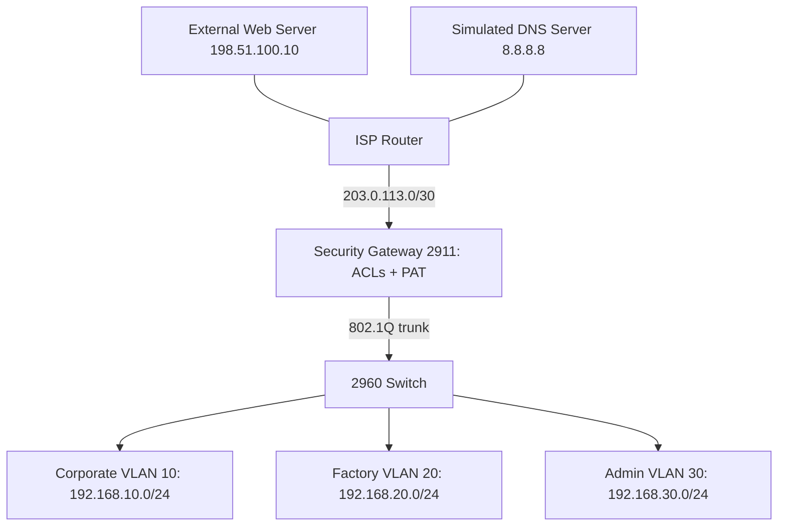

# NS-P02: Manufacturing Firewall and NAT Lab

This project provides a working **browser policy simulation** and a **Cisco Packet Tracer build kit** for a manufacturing network. The uploaded report is a design reference; its claimed results are not treated as measurements from this implementation.

## Run the working demonstration

Requires Python 3.10 or later, with no additional dependencies.

```bash
cd /workspace/firewall
python3 server.py
```

On your own computer, run the same command from the project directory and open your browser at `http://127.0.0.1:8000`. Open **Validation & evidence** and click **Run validation suite**, inspect the decisions and PAT table, then send custom flows. Stop with Ctrl+C. Use `--port 8001` if needed.

```bash
python3 -m unittest discover -s tests -v
```

The upgraded dashboard is self-contained: open `web/index.html` locally without Python, or serve it with `python3 server.py`. Browser session state is independent of the Python API model and clears on reload. Its Validation & evidence view runs 20 checks, supports filtered logs and JSON evidence export; Report coverage summarizes the Word-document audit. See [the full audit](docs/report-audit.md).

The simulation evaluates traffic descriptions; it does not forward real network traffic, perform TLS/SSH handshakes, simulate malware, or enforce host security. Its reverse-flow lookup illustrates a session table without implementing TCP sequence validation, timeouts or connection termination. Reset clears that table. Cisco configuration and software simulation results are separate evidence.

## Architecture



| Initiator | Destination | Allowed service |
|---|---|---|
| Corporate / Admin | Internet | TCP 443 |
| Corporate / Admin | Simulated DNS 8.8.8.8 only | UDP 53 |
| Corporate / Admin | External lab web server only | ICMP echo, for demonstration |
| Admin jump host 192.168.30.10 | Corporate / OT | TCP 22 |
| Admin jump host | SCADA 192.168.20.10 | TCP 3389 |
| Admin jump host | Gateway | SSH management |
| Corporate | OT / Admin | Denied, except limited SSH replies in Cisco ACLs |
| OT | Internet | Denied; no PAT |
| Internet | New internal connections | Denied |

Other routed traffic is denied. Same-VLAN traffic bypasses the gateway. SSH/RDP permits require a listening endpoint; Packet Tracer generic servers do not implement all of these services.

## Cisco Packet Tracer

Follow [the complete assembly and validation guide](docs/packet-tracer.md). Configuration files are in [configs](configs). No binary `.pkt` file is provided: Packet Tracer is unavailable in the cloud environment, and these files have not been executed in Cisco IOS here. Build and validate the topology in Packet Tracer 8.2+ and save your own `.pkt` file.

## Design corrections and limits

- OT inbound rules allow restricted administrative replies; denying all OT packets would break admin sessions.
- WAN ingress rules match the public destination before NAT translation in IOS.
- OT egress is blocked by policy, not merely omission from NAT. This is segmentation, not a physical air gap.
- TCP `established` checks ACK/RST flags, not a state table. The Cisco lab has stateless response exceptions; spoofed packets can match them. UDP response ACLs also do not validate sessions. Use a supported stateful firewall for production.
- PAT conceals translated source addresses; it does not guarantee secrecy of topology or stop malware.
- HTTPS may still carry malicious traffic or exfiltration. L3/L4 ACLs cannot enforce read-only database queries or industrial commands. No database exception is enabled because no reporting host/service was specified.
- Gateway ACLs cannot block Telnet between hosts sharing a VLAN. Use endpoint controls or further segmentation.
- Lab ping is an explicit exception. Remove its permit and echo-reply rules for a stricter HTTPS/DNS-only egress policy.

See [the presentation walkthrough](docs/demo.md) for a short demonstration that distinguishes actual test evidence from intended Cisco behavior.

## Final no-install submission

The final report and six-slide presentation are in `deliverables/`. The updated evidence records 20 browser-model checks, 16 Python test methods, and 13 reporting checks, with scopes kept separate. `python3 reporting_demo.py` demonstrates real local SQLite read-only enforcement and a separate simulated reporting exception using only the standard library. See `docs/reporting-exception.md`. This is the no-install edition; it does not satisfy the original Packet Tracer execution requirement.

## Hosting

Render supports the live SQLite reporting API plus the static dashboard using `render.yaml`. Vercel serves the prebuilt `site/` dashboard, report, presentation and recorded database evidence using `vercel.json`. No local CLI installation is required. See [deployment instructions](docs/deployment.md). The reporting page clearly distinguishes live checks from recorded evidence. Neither host provides Cisco Packet Tracer execution.

## Teacher guide

The comprehensive [project and viva guide](deliverables/NS-P02_Teacher_Guide.md) covers the implemented behavior, technology stack, architecture, security policies, API, database controls, verification, deployment, original-report coverage and classroom demonstration. Word and PDF copies are in `deliverables/`; the hosted printable version is `teacher-guide.html`. Generate with `python3 tools/build_teacher_guide.py` using the existing document-generation environment, then run `python3 tools/build_site.py`. Document-generation packages are development-only and are not needed by the live web service.
